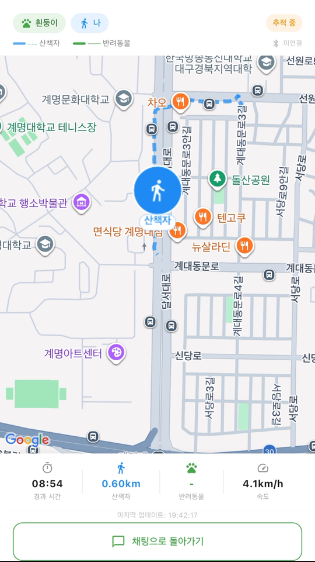
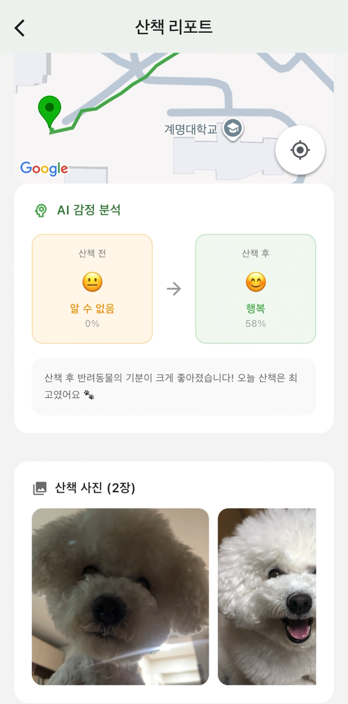
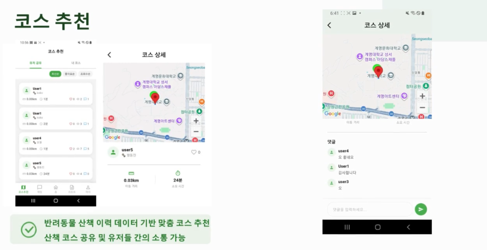
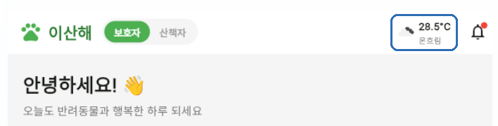

# 이산해 — 반려동물 산책 대행 앱 (캡스톤, 본인 담당 코드)

> 산책자의 GPS 경로를 보호자에게 실시간으로 보여주고, 산책 코스를 공유하는 Flutter 앱입니다.
> 이 레포는 **팀 프로젝트 중 제가 맡은 부분만** 정리한 레포입니다. (원본 팀 레포는 비공개)

| 항목 | 내용 |
|---|---|
| 기간 | 2026.03 ~ 2026.06 (컴퓨터공학과 캡스톤디자인) |
| 팀 | 5명 (팀 404) |
| 담당 | **지도 · 날씨 · GPS 추적 · 코스 공유 · 리뷰 기능** |
| 스택 | Flutter / Dart, Firebase Firestore, Google Maps SDK, Geolocator, OpenWeatherMap API |

<p align="center">
  
  &nbsp;&nbsp;
  
</p>

---

## 담당 기능

| 기능 | 설명 | 코드 |
|---|---|---|
| **지도·경로** | 현재 위치 표시, 산책 시작/종료, 이동 경로를 폴리라인으로 실시간 표시 | [`map_screen.dart`](lib/screens/map_screen.dart) |
| **GPS 서비스** | 위치 권한 처리, 5m 이동마다 좌표 수신, 산책 상태를 싱글톤으로 유지 | [`gps_service.dart`](lib/services/gps_service.dart) |
| **보호자 실시간 추적** | 산책자 좌표를 Firestore에서 실시간 수신 → 경로·거리·평균 속도·경과 시간 표시 | [`gps_tracking_screen_excerpt.dart`](lib/screens/gps_tracking_screen_excerpt.dart) |
| **날씨** | 현재 위치 기반 날씨를 홈 상단에 표시 | [`weather_widget.dart`](lib/widgets/weather_widget.dart) |
| **코스 공유** | 산책 기록을 코스로 공유(공개/비공개), 반경 5km 필터, 최신·좋아요·조회수 정렬 | [`course_list_screen.dart`](lib/screens/course_list_screen.dart), [`my_course_detail_screen.dart`](lib/screens/my_course_detail_screen.dart) |
| **코스 상세** | 공유 코스 경로 표시, 좋아요, 댓글 | [`user_course_detail_screen.dart`](lib/screens/user_course_detail_screen.dart) |
| **리뷰 작성** | 항목별 별점(5개) + 텍스트 리뷰, 산책자 평점 갱신 | [`review_write_screen.dart`](lib/screens/review_write_screen.dart) ※ |

※ 리뷰 작성 화면은 제가 구현했지만, 병합 과정에서 팀장 계정으로 커밋되어 원본 레포 기록에는 팀장 이름으로 남아 있습니다.

<p align="center">
  
</p>
<p align="center">
  
  &nbsp;&nbsp;
  
</p>

---

## 구현하면서 신경 쓴 점

### 1. 화면을 나갔다 들어와도 산책 시간이 이어지게
처음에는 화면 안의 타이머로 경과 시간을 셌는데, 보호자가 채팅 화면으로 갔다가 돌아오면 **0초부터 다시 시작**했습니다.
→ 산책 시작 시각(`walk_started_at`)을 Firestore에 저장하고, 화면은 `현재 시각 − 시작 시각`만 계산하도록 바꿨습니다.
화면 상태가 아니라 **서버에 저장된 값이 기준**이 되므로, 누가 언제 화면을 열어도 같은 시간이 보입니다.

### 2. 좌표를 너무 자주 받지 않게
GPS를 계속 받으면 배터리와 Firestore 쓰기 횟수가 늘어납니다.
→ `distanceFilter: 5`로 **5m 이상 움직였을 때만** 새 좌표를 받도록 했습니다.
또 산책 상태(진행 여부, 경로, 시작 시각)를 `GpsService` **싱글톤**에 두어, 화면을 이동해도 산책이 끊기지 않게 했습니다.

### 3. 코스 공유의 공개 범위와 중복
- `is_public` 필드로 **공개/비공개**를 나누고, 필드가 없는 예전 문서는 공개로 처리해 기존 데이터와 호환되게 했습니다.
- 같은 산책 기록을 여러 번 공유하면 목록에 같은 코스가 쌓이는 문제가 있어, 공유 전에 `room_id + 공유자 uid`로 **이미 공유했는지 먼저 조회**하도록 했습니다.

### 4. API 키를 코드에서 분리
캡스톤 당시에는 날씨 API 키가 코드에 직접 들어 있었습니다. 공개 레포로 옮기면서 키를 빼고 **실행할 때 주입**하도록 바꿨습니다.
```bash
flutter run --dart-define=OPENWEATHER_API_KEY=발급받은_키
```

---

## 계획이 바뀐 부분

원래는 **반려동물 옷에 넣은 아두이노 GPS**와 **산책자 휴대폰 GPS**를 함께 받아,
두 경로를 비교해서 산책자가 위치를 조작하지 않았는지 검증하려고 했습니다.
개발 중 아두이노 GPS 모듈이 고장 나서, 최종 시연은 **휴대폰 GPS 기반 실시간 추적**으로 진행했습니다.
지도 화면에는 반려동물 경로를 따로 그릴 수 있는 구조(산책자: 파란 점선 / 반려동물: 초록 실선)를 남겨두었습니다.

---

## 협업 방식
- 기능별 브랜치에서 작업 → Pull Request → 팀장이 리뷰 후 `main`에 병합
- 결제는 실제 출금이 일어나지 않는 **테스트 모드**로 연동 (팀 기능)

---

## 다시 한다면 개선할 점
- **거리 계산**: 좌표가 들어올 때마다 전체 경로 거리를 처음부터 다시 계산합니다. 마지막 구간만 더하는 누적 방식으로 바꾸면 산책이 길어져도 일정한 비용으로 계산할 수 있습니다.
- **속도 표시**: 화면의 "속도"는 실제로는 *평균 속도*(총 거리 ÷ 경과 시간)입니다. 이름을 "평균 속도"로 바꾸거나, 최근 구간 기준 현재 속도를 따로 보여주는 게 정확합니다.
- **평점 갱신**: 리뷰 저장 후 전체 리뷰를 다시 읽어 평균을 계산합니다. 리뷰가 동시에 들어오면 값이 어긋날 수 있어, 트랜잭션으로 묶는 것이 안전합니다.

---

## 폴더 구조
```
lib/
├── screens/
│   ├── map_screen.dart                    # 지도·산책 시작/종료·경로
│   ├── gps_tracking_screen_excerpt.dart   # 보호자 실시간 추적 (본인 작성 부분 발췌)
│   ├── course_list_screen.dart            # 코스 목록·공유·필터·정렬
│   ├── my_course_detail_screen.dart       # 내 코스 상세·공유
│   ├── user_course_detail_screen.dart     # 공유 코스 상세·좋아요·댓글
│   └── review_write_screen.dart           # 리뷰 작성
├── services/
│   └── gps_service.dart                   # 위치 권한·좌표 스트림·산책 상태
└── widgets/
    └── weather_widget.dart                # 위치 기반 날씨
docs/images/                               # 실행 화면
```

> 이 레포는 **코드 열람용**입니다. 팀 공용 코드(로그인, 채팅, 결제, AI 분석 등)와 Firebase 설정 파일은 포함하지 않아 단독으로 빌드되지는 않습니다.
